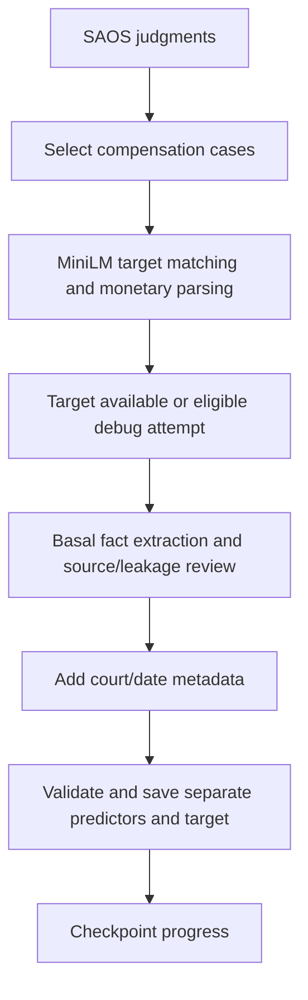

# Extraction

[Back to the project overview](../README.md) · [Run acquisition](acquisition.md) · [Prepare numeric inputs](preprocessing.md)

The pipeline turns a judgment into **factual predictors** and a separate **monetary target**. These are candidate training examples, not compensation predictions. The authoritative extraction policy and known risks are in [PROJECT.md](../PROJECT.md).

## Flow



Target selection happens before feature extraction; missing judgment matches skip text-feature inference unless a denial established zero. See [basal_filtering.py](../src/dataset/extraction/basal_filtering.py) for the coordinator and [quality.py](../src/dataset/extraction/quality.py) for admission checks.

## MiniLM: choose the target passage

[target_matching.py](../src/dataset/embeddings/target_matching.py) embeds configured examples and candidate passages, then compares their cosine similarity. MiniLM supplies vectors and similarity-based matches; it does not generate the numeric award or predict compensation from case facts.

1. **Check full denial first.** Every complete sentence is eligible, including sentences without amounts or role keywords. A denial match must strictly exceed the configured threshold and beat the strongest procedural-cost pattern for the same sentence; costs win ties. A recognized denial supplies a confirmed zero target, skips monetary parsing and continues normal feature validation. The matcher stops at the first matching batch, retaining the strongest denial in that batch.
2. **Otherwise, find monetary candidates.** Keep each sentence's beginning through its first comma-delimited part containing a numeric PLN amount. Decimal commas remain intact. Stop there regardless of keywords or similarity; do not examine later parts of that sentence.
3. **Compare eligible prefixes.** Only monetary prefixes with configured role keywords reach monetary matching. Award/request roles compete with prior-payment, procedural-cost, mixed and other-payment exclusions. Each prefix has one highest-scoring eligible class; exact ties favor exclusions. Retain the strongest winner per class strictly above the configured threshold, currently `0.7`. A judgment match is required and a request match is optional.
4. **Parse the selected award.** [targets/](../src/dataset/extraction/targets/) resolves numeric amounts from the selected source span. Similarity selects the passage; monetary parsing establishes the amount.

The target is one case-level total in PLN: awarded one-off principal, not requests, costs, interest, rent or prior payments. Explicit per-person awards may be aggregated across identified beneficiaries. Separate unselected sentences are not scanned and summed, and ambiguous selected amounts are rejected rather than guessed. Cost settlements/offsets are exclusions, not proof that the claim was denied.

## Basal: extract and review facts

[features.py](../src/dataset/extraction/features.py) selects the factual-findings section, falling back to the reasoning body when explicit headings are absent. It extracts configured text fields together in sentence-aligned batches, then reviews selected source candidates. There is no second extraction pass outside that primary section.

| Text field | Question addressed |
|---|---|
| `cause` | What caused the harm? |
| `damage` | What harm or loss occurred? |
| `limitations` | What activities became difficult or impossible? |

The Polish questions come from [features.yaml](../configs/dataset/acquisition/features.yaml). Basal checks source support, factuality, field relevance and target leakage; the same configured question guides extraction and relevance review. Unsupported information stays missing. Basal also determines procedural instance from textual evidence and confirms earlier principal payments for `prior_payment`.

Additional predictors include judgment year, beneficiary count and court-locality population category. See [metadata.py](../src/dataset/acquisition/metadata.py) for enrichment. The court-locality category uses a GUGiK population snapshot, not historical population at the judgment date.

## Leakage and admission

Predictor text must not disclose the awarded/requested amount, monetary calculations, earlier payments, the outcome, or reasoning that justifies the amount. `prior_payment` is an explicitly allowed numeric predictor; its monetary source passage must not become a text feature.

Every retained case, including debug records, requires accepted source-backed `damage` evidence. Valid records also require an admissible target. Debug may retain an eligible unresolved target as `valid: false`, but populated text still undergoes source and leakage checks. Files and recovery behavior are described in [acquisition](acquisition.md#output-and-admission).

## Reusable text embeddings

```python
from dataset import load_config
from dataset.embeddings import create_embeddings

settings = load_config()["embedding"]
vectors = create_embeddings(["Opis szkody.", "Ograniczenia w pracy."], settings)
```

[encoding.py](../src/dataset/embeddings/encoding.py) accepts a nonempty list of nonblank strings and encoder settings (`model`, `revision`, `device`, `batch_size`, `max_length`). It returns an `(N, D)` float32 PyTorch tensor on the selected device, preserving order and pooling all token windows. Loading is lazy and cached for unchanged encoder settings. General encoding preserves original text; monetary normalization belongs only to target matching. This example may download weights and run inference. [Device setup](acquisition.md#models-and-devices) applies here too.

## Limitations

Cosine similarity is not calibrated legal confidence. Denial matching does not independently verify speaker, procedural stage or quoted context, so a request or earlier denial may incorrectly yield zero. Monetary matching may confuse requests, costs or earlier payments with awards. Context from earlier sentences and qualifiers after the first monetary prefix may be lost; separate awards can be missed. Fully written-out monetary amounts are unsupported.

Facts can still have relevance or attribution errors despite automated reviews. Before training, independently label representative targets and evidence, measure extraction quality and review leakage. `valid: true` is an admission result, not proof of a correct label.
