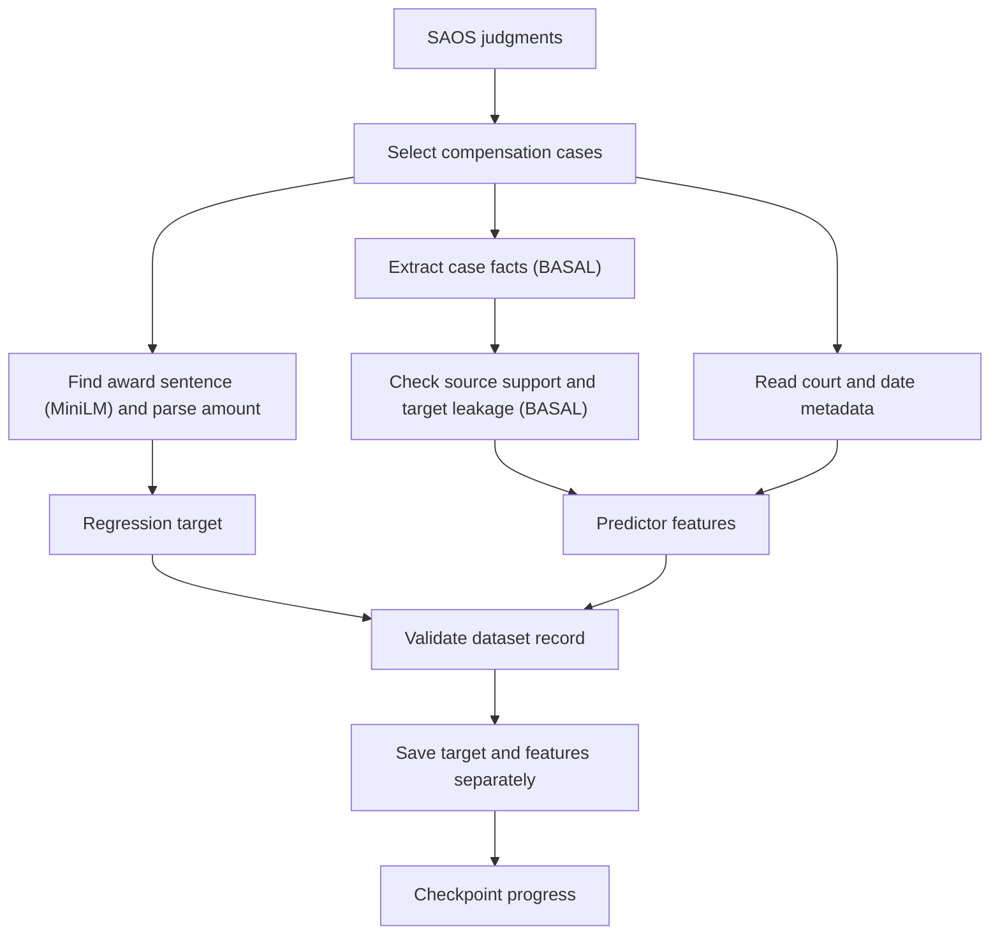

# Pipeline

[Back to README](../README.md)

## How get-data pipeline works

1. Download judgments from SAOS and keep relevant compensation cases.
2. Find the awarded amount using sentence matching and monetary parsing.
3. Extract case facts and check their source support and target leakage.
4. Save accepted records and checkpoint progress for resuming later.

