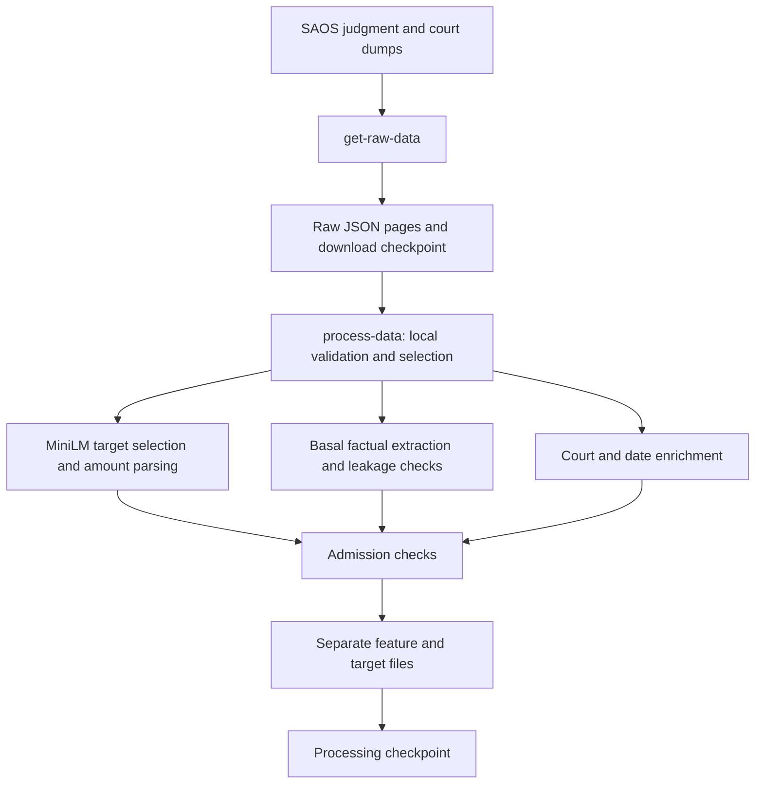

# Pipeline

[Back to README](../README.md)

## Independent stages

`get-raw-data` downloads date-bounded SAOS judgment pages and common-court metadata. It validates the API envelope and pagination, then atomically saves complete JSON responses, including HTML and unknown fields. It does not filter cases, normalize text, join metadata, embed sentences or load Basal.

`process-data` reads a fixed local raw snapshot. It selects common-court compensation judgments, validates and joins court metadata, normalizes text, finds targets, extracts factual predictors and checks leakage. Raw JSON remains unchanged. Accepted outputs and processing progress go to a separate directory. Processing makes no SAOS requests; model/locality caches retain their existing independent download behavior.

Each stage resumes independently. Multiple processing runs can reuse the same raw snapshot with different extraction configuration and separate output paths. Finish downloading before processing that snapshot; extending or editing raw input invalidates an existing processing checkpoint.
