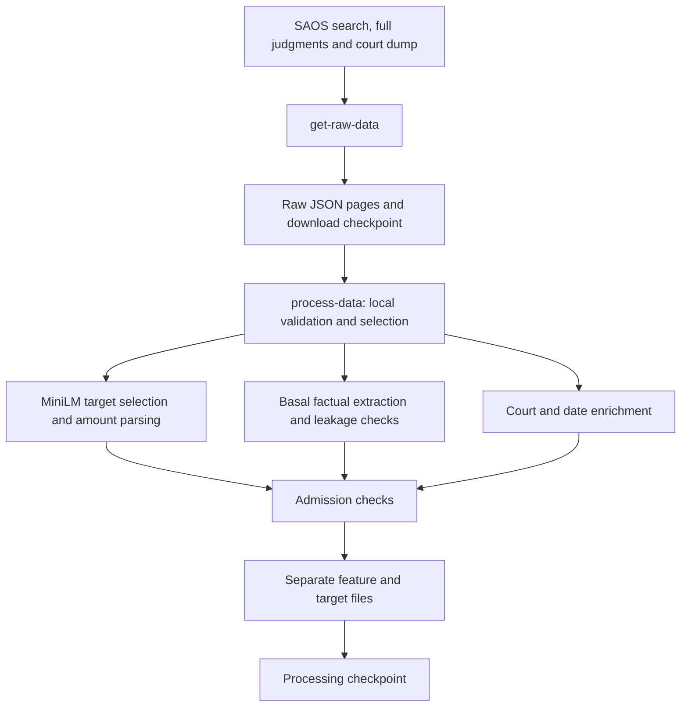

# Pipeline

[Back to README](../README.md)

## Independent stages

`get-raw-data` searches date-bounded common-court sentences using the configured broad full-text query (default `zadośćuczynienie`), then downloads every full judgment by ID. It saves search envelopes with full sources in `items` and original snippets in `searchItems`, preserving HTML and unknown fields. Court metadata still uses the dump endpoint. It does not normalize text, join metadata, embed sentences or load Basal. Numeric PLN validation remains local in `process-data`.

`process-data` reads a fixed local raw snapshot. It selects common-court compensation judgments, validates and joins court metadata, normalizes text, finds targets, extracts factual predictors and checks leakage. Raw JSON remains unchanged. Accepted outputs and processing progress go to a separate directory. Processing makes no SAOS requests; model/locality caches retain their existing independent download behavior.

Each stage resumes independently. Multiple processing runs can reuse the same raw snapshot with different extraction configuration and separate output paths. Finish downloading before processing that snapshot; extending or editing raw input invalidates an existing processing checkpoint.
